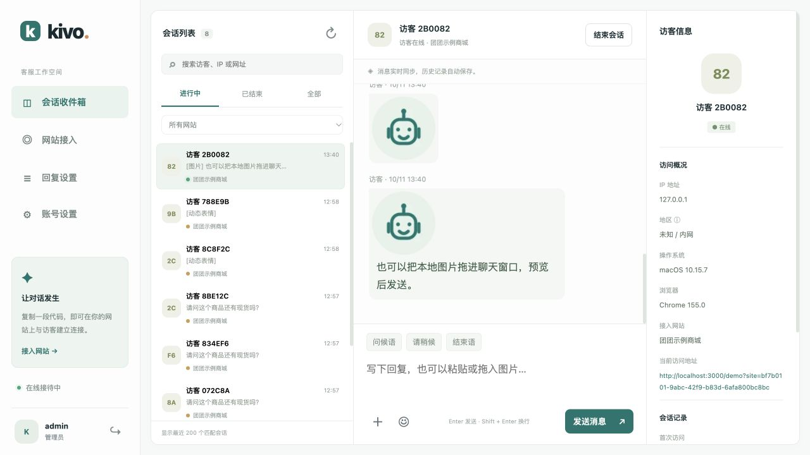
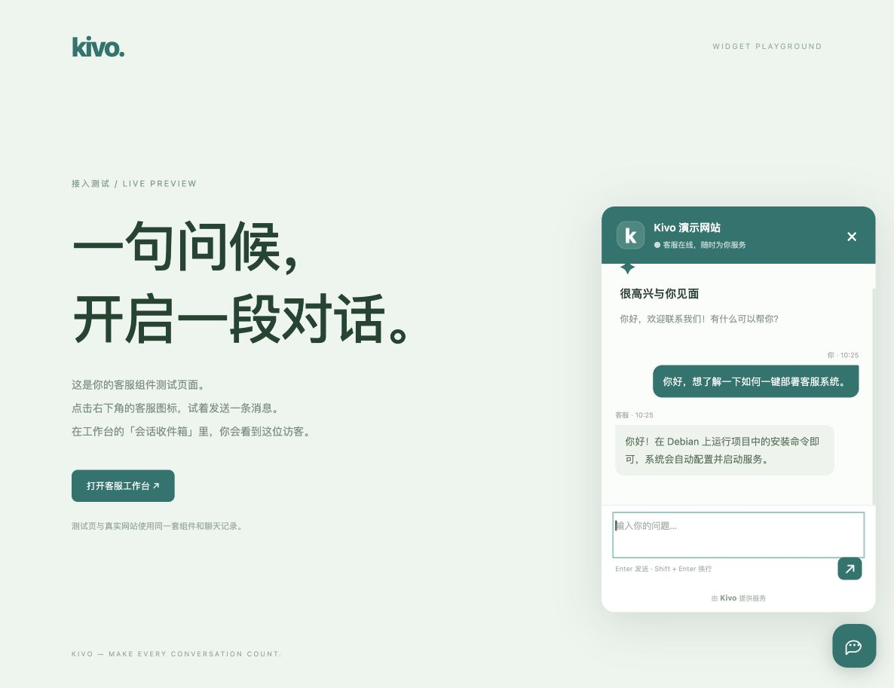

# Kivo · 在线客服系统

自托管的中文客服工作台。添加一段 JavaScript，网站右下角就会出现客服图标，访客和客服可以实时聊天。




## 功能

- 网页浮动客服组件：自定义客服名称、头像、颜色和欢迎语，圆角聊天窗口、呼吸光圈与悬停动画，iframe 隔离样式，适配手机。
- 客服后台：全高加宽、紧凑访客卡片的会话列表、未读数量、搜索、网站筛选、可编辑常用话术、结束 / 重新打开会话。
- 按网站配置首次留言和离线自动回复，自动回复保存到聊天记录并显示标识。
- 访客信息：在线状态、IP、估算地区、当前访问地址、操作系统、浏览器、首次访问时间；支持 SPA 地址更新。
- 双方可选择、粘贴或拖入图片，发送普通表情与原创「团团」动态表情；图片支持点击放大。客服窗口最大 460 × 760，双方聊天正文和输入文字为 16px。
- Socket.IO 实时消息、断线重连、历史记录、访客凭证恢复会话；支持加载更早消息。
- 多网站接入：生成独立嵌入代码、指定允许来源或允许所有网站、网站配置与测试页面。
- PHP 网站登录用户对接：后端签名校验，后台显示 / 搜索用户 ID、账号和昵称；同账号跨设备恢复历史，匿名及不同账号互相隔离。
- 简化 PHP 接入：嵌入代码直接读取 Session 的 username 作为访客名称，缺少时显示默认访客，无需身份接口或签名配置。
- 管理员密码哈希、HttpOnly Cookie、请求来源校验、登录及消息频率限制、修改密码撤销登录。
- Docker 镜像一键安装、升级前在线备份、健康检查及失败回退。

## Docker 一键安装（默认 8088）

支持 **Debian 10 / 11 / 12 / 13、amd64 / arm64**，Linux 内核 **4.18+**（Debian 10 默认 4.19）。建议 1 GB 内存、3 GB 可用空间，需要访问 GitHub；首次安装独立运行时还需访问 Docker 官方下载站。

在 root 终端执行：

```bash
curl -fsSL https://raw.githubusercontent.com/hainiu6/kivo/main/scripts/install.sh -o /tmp/kivo-install.sh && bash /tmp/kivo-install.sh
```

普通账号请使用 `sudo bash /tmp/kivo-install.sh`。安装包已包含镜像，服务器**无需 Git、npm、Node.js、MariaDB 或 Docker Compose**。安装器不调用 apt / dpkg；截图中的 MariaDB 软件包错误不会阻挡此安装。

- 已有 Docker：先检查本机 socket 与服务端版本，要求 Docker 20.10.10+。服务未启动时尝试启动；运行中的服务不会被重启，也不重装 Docker。连接检查通过后才下载镜像。
- 没有 Docker：下载并校验官方静态 Docker 29.8.2，放在 `/opt/kivo/runtime/`，使用独立 `kivo-docker.service`、socket 和存储目录。不会向 `/usr/bin` 安装 Docker，也不改 `/etc/docker`。
- 默认只发布 **8088 → 容器 3000**，不占用 80 / 443。8088 被占用时自动尝试 8089–8107；显式指定端口被占用则退出。
- 数据在 `/opt/kivo/data`，配置在 `/opt/kivo/.env`；初始账号 `admin`，随机密码在安装完成时显示并保存在 `.env`。登录后可修改密码。

安装成功后访问显示的后台地址，并在服务器防火墙 / 云安全组放行实际端口。安装器不配置云安全组或额外放行规则；Docker 会创建容器所需的网络规则。已有同名容器会退出，不会覆盖它。

安装器识别本机 Docker context / `DOCKER_HOST` 的 Unix socket，并兼容 `/run/docker.sock` 与 `/var/run/docker.sock`。执行已选定的本机连接时会排除继承的 context、TLS 和 API 版本覆盖。自定义本机 socket 可通过 `KIVO_DOCKER_SOCKET=unix:///自定义路径/docker.sock` 指定；远程 Docker 不支持宿主机数据挂载，会明确拒绝。

如果连接检查失败，安装器会显示**当前主机名、客户端路径、连接 socket 和原始错误**，不会反复下载镜像后才报错。请在安装失败的同一台服务器执行 `systemctl status docker --no-pager -l`、`journalctl -u docker -n 30 --no-pager` 排查。连接检查使用服务端版本查询，不把 `docker info` 的其他错误误报为「服务未启动」。

若服务器在 NAT 后，指定正确公网地址（替换示例 IP）：

```bash
KIVO_PUBLIC_URL=http://203.0.113.10:8088 KIVO_PORT=8088 bash /tmp/kivo-install.sh
```

`PUBLIC_URL` 必须与浏览器访问后台的协议、主机及端口一致，否则登录来源校验会拒绝请求。可用 `KIVO_INSTALL_DIR=/opt/kivo-other KIVO_CONTAINER=kivo-other KIVO_PORT=8090` 部署另一个实例。目录须为不含空格的绝对路径，容器名称须以 `kivo` 开头。

安装依赖服务器已有 `curl`、`tar`、`gzip`、`awk`、`sha256sum`、`od`、`flock`、`tr`、`hostname` 等基础工具；独立运行时还需 systemd、iptables、ps、mount 和 cgroups。缺失时会明确报错，不会使用 apt 修复系统。独立 Docker 会创建自己的网桥和容器网络规则，仍需要宿主机允许容器运行。

Debian 10 是兼容目标，已不在当前 Docker 官方 apt 安装支持列表中。采用静态运行时避开软件源依赖；静态 Docker 不会自动更新，后续运行时安全更新需单独维护。发布测试覆盖两个架构的 Debian 10 用户空间；CI 使用较新宿主机内核，未在真实 Debian 10 / 4.19 服务器上验证。依据：[Docker 静态二进制安装](https://docs.docker.com/engine/install/binaries/)、[Docker Debian 安装要求](https://docs.docker.com/engine/install/debian/)、[Node 24 平台要求](https://github.com/nodejs/node/blob/v24.11.1/BUILDING.md)。

## HTTPS 与已有网站共存

HTTPS 网站应使用 HTTPS 客服地址，避免浏览器阻止混合内容。沿用服务器已有 Nginx / Caddy 的 HTTPS 域名与证书，将客服域名反向代理到 `127.0.0.1:8088`。

编辑 `/opt/kivo/.env`，保留其他项：

```dotenv
PUBLIC_URL=https://chat.example.com
HTTP_PORT=8088
BIND_HOST=127.0.0.1
TRUST_PROXY=1
```

然后执行升级命令重新创建容器。以下是已有 Nginx HTTPS `server` 中的 `location` 配置（若实际端口改变，请同步修改）：

```nginx
location / {
    client_max_body_size 6m;
    proxy_pass http://127.0.0.1:8088;
    proxy_http_version 1.1;
    proxy_set_header Upgrade $http_upgrade;
    proxy_set_header Connection "upgrade";
    proxy_set_header Host $host;
    proxy_set_header X-Forwarded-Proto $scheme;
    proxy_set_header X-Forwarded-For $remote_addr;
    proxy_set_header X-Real-IP $remote_addr;
    proxy_read_timeout 300s;
}
```

访客 IP 显示 `172.17.0.1` 等 Docker 网关地址时，先确认宝塔反向代理包含上述 `X-Forwarded-For` / `X-Real-IP` 配置，再把 `.env` 的 `TRUST_PROXY` 设为 `1`、`BIND_HOST` 设为 `127.0.0.1`，运行升级脚本重新创建容器。不要只执行 `docker restart`，它不会载入修改后的环境变量。浏览器刷新或重连后，IP 和地区将按当前连接更新。

## 删除聊天记录

v1.5.0 支持消息旁的「删除」、当前会话的「清空记录」和「删除会话」，以及会话列表顶部的「批量删除」。可删除全部、7 天前或一个月前（30 天）的会话；时间按最近消息计算，批量删除可限定当前所选网站，并覆盖所有状态及列表外的会话。确认窗口会显示删除数量。

v1.5.1 新增访客新消息提示音、标签标题未读数字和图标红点；未读统计覆盖所有网站和列表外的会话。浏览器需点击后启用声音，可在左侧菜单开启或静音。菜单默认折叠成图标栏，可展开并记住选择，详见 [新消息提示与折叠菜单](docs/message-notifications.md)。

v1.6.0 改为更响亮的四音提醒，管理员登录保持 30 天，刷新恢复当前页面、会话、筛选和文字草稿。后台输入框包住图片、表情和发送按钮；访客收到新回复自动展开窗口。新增奶猫、水豚、机器人三套共 18 个动态表情，两端均可发送，详见 [工作台与表情更新](docs/workspace-update.md)。

v1.7.0 新增 [数据统计页面](docs/statistics.md)：按时间及网站查看会话、消息、在线访客、未读数量、每日趋势、消息类型和网站分布。回复框聚焦描边完整包住底部按钮，点击会话自动聚焦输入框；右侧 IP 与地区以醒目卡片显示。

v1.8.0 改用简洁的一声“叮”提示音，放大左下角声音、接待状态及账号图标。新增客服在线／离线开关，会话卡片缩为两行并明确标注访客在线／离线；收件箱显示所有网站的实时在线访客数，详见 [接待状态与紧凑会话列表](docs/support-presence.md)。

v1.8.2 更新大号耳麦笑脸客服图标，并优化右侧访客信息的分组、密度和空字段展示，详见 [客服按钮与访客信息](docs/visitor-inspector.md)。

v1.9.0 新增独立 [访问统计模块](docs/traffic-analytics.md)：添加统计站点后复制一段 JS 即可接入任意域名，查看 PV、UV、IP / 地区、页面排行、域名及来源分布和每日趋势。

v1.9.1 放大访客端客服在线／离线状态提示，移除双方输入框的键盘提示文字，并提高新消息“叮”声的音量及辨识度，详见 [接待状态与提示音](docs/support-presence.md)。

v1.10.0 新增 [桌面与手机客户端接入接口](docs/client-api.md)，支持用户资料传递、实时聊天与图片、短期凭证刷新 / 撤销、跨设备历史及 OpenAPI 文档。

v1.11.0 新增客服消息的访客已读状态；同一浏览器在同一网站来源、同一站点的不同页面复用会话，修复首次多标签同时访问的重复会话问题。会话列表在线优先，离线满 10 分钟自动结束并保留记录；用户再次上线可恢复自动结束的会话。消息、图片与表情更新保留已有节点，修复聊天记录闪动。详见 [已读状态与会话管理](docs/conversation-behavior.md)。

v1.11.1 保留离线超过 10 分钟但尚未获人工回复的会话；查看消息和自动回复不算已回复。新增 5 种更响亮的提示音，在「账号设置 → 新消息提示音」中选择、试听并自动保存，详见 [提示音选择](docs/message-notifications.md)。

v1.11.2 新增短促清脆的「微信风格」提示音，在「账号设置 → 新消息提示音」中选择第 6 项即可使用。

v1.11.3 将第 6 项替换为用户视频前 1 秒的「微信消息」原声，并增强音量；原来的「微信风格」选择自动对应到新录音。

v1.11.4 按最新选择将「微信消息」提示音更新为视频前 2 秒的原声片段，保留完整提示音并增强音量。

v1.13.0 为访问统计的每日趋势增加即时 PV / UV 提示；新增「定制节点」页面，支持添加、编辑账号、节点编号、开始与结束时间、备注及多行长文本节点。支持搜索与分页，数据随备份和升级保留。使用说明见 [定制节点与趋势提示](docs/custom-nodes.md)。

v1.12.0 移除左侧「让对话发生」引导卡片，右侧访客信息新增仅客服可见的备注，支持保存、修改和清空，多客服实时同步，刷新与升级后保留。详见 [访客备注](docs/visitor-inspector.md#访客备注)。

v1.11.5 去掉「微信消息」开头约 0.8 秒空白，使新消息提示立即响起；保持增强后的音量。

v1.9.2 更新本地国家数据库，修复 `179.255.146.39`、`179.255.158.39` 被旧库误识别为巴西的问题；客服与访问统计的历史地区显示随新库更新，无需删除记录。支持自定义 Country / City MMDB，详见 [IP 地区识别](docs/geolocation.md)。

删除会同步到在线访客窗口及其他客服，并清理相关图片；完整会话删除后，访客可以开始新对话。详细行为与截图见 [记录管理](docs/history-management.md)。

`TRUST_PROXY=1` 仅用于这一层可信代理；应用同时绑定回环地址。存在 CDN / 多层代理时，应按你的代理链配置可信来源和真实 IP。直接 IP 访问使用 `TRUST_PROXY=0`。

## 一键升级

项目已迁移到 [hainiu6/kivo](https://github.com/hainiu6/kivo)。新安装和 v1.13.1 起的安装包默认使用新仓库。

**此前从旧仓库安装的 Docker 镜像版，首次切换请执行：**

```bash
KIVO_RELEASE_BASE=https://github.com/hainiu6/kivo/releases bash /opt/kivo/scripts/upgrade.sh
```

成功后，后续使用下面的常规升级命令即可。此次切换保留现有 `.env`、数据、账号、图片和访客备注。

旧版 Git / Compose 部署请先修改仓库地址，再执行原升级脚本：

```bash
git -C /opt/kivo remote set-url origin https://github.com/hainiu6/kivo.git
bash /opt/kivo/scripts/upgrade.sh
```


```bash
bash /opt/kivo/scripts/upgrade.sh
```

下载最新 GitHub Release → SHA256 校验 → 导入镜像 → 在线备份 → 替换 Kivo 容器 → 等待健康检查。下载和导入期间旧服务保持运行；重启期间聊天短暂断开，组件会重连。升级保留配置、账号、聊天记录和图片，不改其他容器。

新容器启动失败会恢复旧容器。数据库不会自动回滚，以免覆盖新消息；未来不兼容的数据迁移需按对应发行说明恢复备份。镜像与备份不会自动删除，便于回退。

指定已发布版本：

```bash
KIVO_VERSION=v1.12.1 bash /opt/kivo/scripts/upgrade.sh
```

## 客户端接入

Windows / macOS / Linux / Android / iOS 客户端可通过 [客户端接口文档](docs/client-api.md) 接入：业务后端签发短期凭证，客户端创建会话并传递用户 ID、账号、昵称及自定义资料。提供 HTTPS 聊天、图片、历史分页、退出撤销和 Socket.IO 实时协议，以及 [OpenAPI 定义](public/client-api.openapi.json) 和可运行示例。后台展示客户端平台、版本、设备及当前页面；同站点同用户跨设备恢复历史。

## 网站接入

1. 登录后台，打开 **网站接入 → 添加网站**。
2. 填写网站名称、客服名称、上传客服头像、选择图标颜色和欢迎语。可勾选 **允许所有网站**，在任意 HTTP / HTTPS 网站使用同一段代码；也可指定允许来源，例如 `https://www.example.com`，裸域、其他子域和不同端口须分别填写。这个选项只影响访客接入，后台登录和修改设置仍要求后台自身来源。
3. 保存，复制生成的嵌入代码，放在 HTML 的 `</body>` 前：

```html
<script src="https://chat.example.com/widget.js" data-site="后台生成的网站 ID" async></script>
```

4. 打开网站，点击右下角图标发送消息；后台会话列表实时出现对话。也可先使用后台「打开测试页面」。

只需显示网站 Session 中的 `username` 时，按 [Session 直接显示说明](docs/session-name.md) 替换 PHP / Blade 嵌入代码，设置 `data-visitor-name`；读不到时显示默认访客，无需额外接口、路由或密钥。名称仅用于显示，聊天和图片权限仍由独立访客凭证控制。

需要验证账号并跨设备恢复历史时，打开网站卡片的 **用户对接**，生成后端签名密钥，按 [签名身份接入说明](docs/php-integration.md) 配置。仓库提供普通 PHP 和针对 Laravel 5.4 的示例，由你自行复制到网站；密钥只保存在 PHP 后端。单页网站在 AJAX 登录、退出或切换账号成功后调用 `window.Kivo?.refreshIdentity()`。

有 CSP 的网站请允许客服域名的 `script-src`、`frame-src` 和 `connect-src`，加载器内联样式也需相应的 `style-src` 许可。嵌入代码不包含管理员凭证。

访客国家由本地 DB-IP Lite 数据估算，城市信息仅在旧库国家与新库一致时保留；内网通常显示「未知 / 内网」，VPN / 代理会影响结果，详见 [IP 地区识别](docs/geolocation.md)。地区查询在本地完成，页面保留 DB-IP 来源链接及 geoip-lite 包内授权。当前 URL 每 2 秒检测 SPA 变化，多标签页显示最近上报的地址。组件存储随机访客凭证并收集 IP、URL；在网站隐私说明中说明用途，页面 URL 不应含密码等秘密。

## 常用话术与自动回复

- **回复设置 → 常用话术**：添加、编辑或删除话术后点击「保存话术」。最多 20 条，每条名称 40 字符、内容 2000 字符。点击聊天输入框上方的话术按钮会填入内容，可修改后发送；不会直接发送。
- **网站接入 → 编辑设置 → 自动回复**：每个网站分别启用「首次留言自动回复」和「客服离线自动回复」，内容最多 2000 字符，默认关闭。
- 首次留言回复在一个会话第一次收到访客消息时发送一次。离线表示没有登录且连接到工作台的客服；离线回复在访客发消息时触发，同一会话最多 5 分钟一次。两项同时启用时，首次回复优先，并计入 5 分钟间隔。
- 自动回复在双方聊天记录中标记为「自动回复」，不会增加未读数。重复发送确认、刷新、重连或服务重启不会重发首次回复或重置离线间隔。
- 设置、话术、聊天记录均保存在 SQLite 中。一键升级会自动补充数据表，保留原有网站和会话，无需重新接入。

## 图片、头像与表情

- **网站接入 → 编辑设置**：每个网站设置客服名称、上传头像或恢复默认机器人。客服窗口不展示底部版权。
- 双方输入框旁的「＋」可选择图片，也可直接粘贴截图或将本地图片拖入聊天窗口。拖入时显示提示，先预览，再点发送；可添加说明文字或移除附件。每次一张，支持 PNG、JPEG、GIF、WebP，原文件不超过 5 MB、2500 万像素、80 帧。自动缩放为最大 1600 像素并转为 WebP，移除元数据；聊天 GIF 保留动画，头像裁剪为 160 × 160。
- 图片和头像使用标准 multipart 表单上传，兼容旧版原始图片上传接口。代理返回非 JSON 错误页时显示中文原因及 HTTP 状态码；若显示 HTTP 413，请在反向代理中将 `client_max_body_size` 设置为 `6m` 或更高。升级后强制刷新后台和接入网站，使浏览器加载新版脚本。
- 点击笑脸可插入普通表情，或选择「团团」8 款动态表情：嗨、比心、好耶、哈哈哈、委屈、等一下、喝杯咖啡、谢谢啦。动态表情可预览后发送，历史记录保留动画。系统开启减少动态效果时会停止动画。
- 图片保存在 `data/media/`，升级和备份同时保留。聊天图片需要管理员登录或对应访客凭证才能读取；客服头像用于公开展示。图片存储总上限 1 GB、每会话 50 MB，超限会明确提示。
- 操作系统与浏览器依据访客 User-Agent 识别，旧访客下次打开组件后补充；浏览器可能简化信息，例如 Windows 10 / 11 显示为同一项，结果供参考。

## 备份与维护

以 root 执行（普通账号加 sudo）：

```bash
bash /opt/kivo/scripts/backup.sh
bash /opt/kivo/scripts/docker.sh ps
bash /opt/kivo/scripts/docker.sh logs -f --tail 100 kivo
bash /opt/kivo/scripts/docker.sh restart kivo
bash /opt/kivo/scripts/docker.sh stop kivo
bash /opt/kivo/scripts/docker.sh start kivo
```

`docker.sh` 自动选择安装时的运行时，适用于系统 Docker 和独立 Docker。自定义容器名时将 `kivo` 替换为实际名称。服务和数据互相独立；停止容器保留聊天记录。

在线备份在 `/opt/kivo/backups/时间戳/`，包括一致的 SQLite 快照（含已提交 WAL 数据）、`media/` 图片目录、`.env`、`deployment.env` 与 `runtime.env`。配置和备份权限为仅拥有者可访问。建议复制备份到其他机器。

恢复会覆盖数据库，先备份当前数据，再选择正确的备份（替换示例时间戳）：

```bash
cd /opt/kivo
bash scripts/backup.sh
bash scripts/docker.sh stop kivo
cp backups/20261011T020000Z-1234/kivo.sqlite data/kivo.sqlite
rm -f data/kivo.sqlite-wal data/kivo.sqlite-shm
mkdir -p data/media
if [ -d backups/20261011T020000Z-1234/media ]; then
  cp -a backups/20261011T020000Z-1234/media/. data/media/
fi
chown -R 1000:1000 data
chmod 700 data/media
chmod 600 data/kivo.sqlite
bash scripts/docker.sh start kivo
```

恢复旧版本数据库时，依据备份 `deployment.env` 的 `KIVO_VERSION` 选择对应镜像版本；只有需要时才恢复 `.env`。不要公开 `.env`、数据或备份。

### 旧版 Compose 安装

已有 Git / Compose 部署可继续使用原目录的 `scripts/upgrade.sh` 和 `scripts/backup.sh`，脚本会识别并使用保留的 Compose 流程。它仍需要 Git / Compose 与本地构建，不能享受免 apt 的新安装流程；不会自动迁移或覆盖旧数据库。

旧安装失败且 `/opt/kivo` 已有 `.git` 与 `.env` 时，新镜像版会拒绝覆盖。可用 `KIVO_INSTALL_DIR=/opt/kivo-docker KIVO_CONTAINER=kivo-docker` 安装到新目录。需要迁移已有聊天记录时，先在线备份旧库，在新容器停止期间复制数据库并保留原账号配置。

仓库的 `compose.yaml` 保留供本地开发 / 原部署使用，默认 HTTP 8088、HTTPS 8443。镜像版安装不启动 Caddy；已有域名使用上面的反向代理方案。

## 开发与发布

需要 Node.js 24+，使用内置 `node:sqlite`，无需外部数据库；测试 PHP 签名示例另需 PHP CLI（示例语法兼容 PHP 5.6+，本地在 PHP 7.4 验证）：

```bash
npm ci
cp .env.example .env
```

编辑 `.env` 为 `PUBLIC_URL=http://localhost:3000`、`TRUST_PROXY=0`，设置至少 12 字符的 `ADMIN_PASSWORD`，然后 `npm run dev`。只在数据库首次创建时初始化管理员，已有账号请通过后台修改密码。

```bash
npm run check
npm test
npm audit --omit=dev
for file in scripts/*.sh test/*.sh; do bash -n "$file"; done
```

应用集成测试覆盖真实 HTTP / Socket.IO 登录、来源校验、双向消息、访客隔离、历史持久化、在线备份和 HTTP 消息 ID，以及允许所有网站、后台来源隔离、常用话术保存、自动回复触发与去重、离线间隔持久化和旧数据库迁移；图片上传、访问隔离、头像设置、动态表情去重、设备识别和重启后图片读取。CI 保留 Compose 测试；Docker release 工作流在原生 amd64 / arm64 runner 构建，使用 Debian 10 测试容器验证默认 8088、占用自动换端口、容器保护、备份、升级、数据保留、失败回退与校验失败。测试夹具中 apt 仅用于预装测试工具，正式部署脚本不会调用 apt / dpkg。

独立运行时测试在特权 Debian 10 容器中启动真实 dockerd，验证独立 socket、存储、网桥及应用健康状态；测试适配器执行生成的 systemd 单元启动命令，完整 systemd 启动流程与 4.19 内核仍需在目标服务器验证。运行时配置依据 [dockerd 官方参数文档](https://docs.docker.com/reference/cli/dockerd/)。

在 GitHub Actions 手动运行 **Docker release** 并指定新版本号，或推送 `v*` 标签，即可发布双架构安装包、SHA256SUMS、version.txt。服务器安装器下载 Release 附件，不需要镜像仓库账号。安装包包含镜像与安装 / 升级脚本，升级跟随已测试发行版本。

PHP 对接测试覆盖 PHP / Node 签名互通、伪造与过期凭证、账号和匿名隔离、同账号多设备、图片授权、密钥重置和数据库重启保留；Docker 升级测试同时验证用户关联和签名密钥保留。

目前为单实例、单管理员的客服系统，支持图片附件，不包含其他文件上传、客服分配或多管理员管理。SQLite 与内存在线状态适用于单机部署，请勿直接横向扩容多个实例。

技术栈：Node.js 24 / Express / Socket.IO / SQLite / Docker，原生 HTML、CSS、JavaScript 前端。
