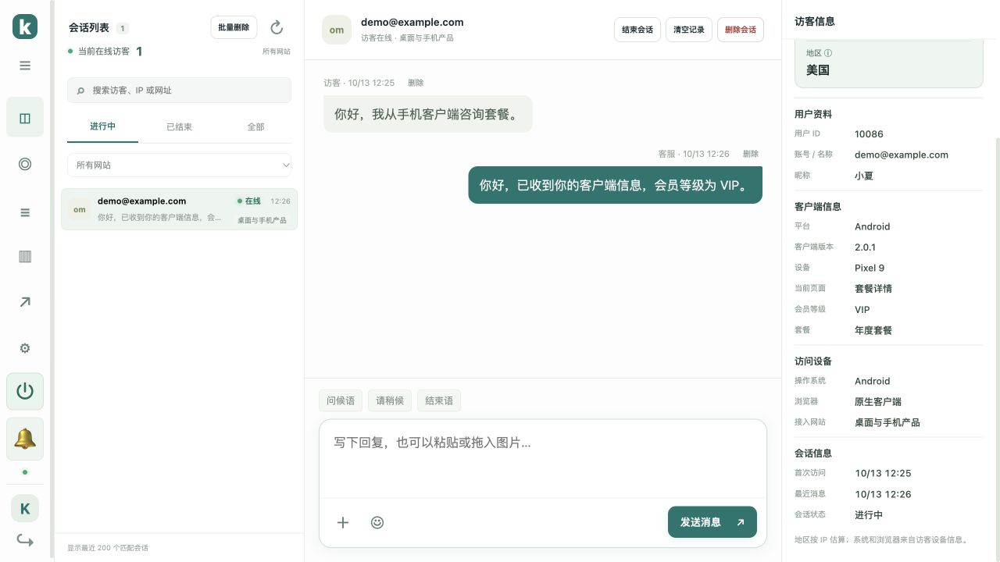

# 桌面 / 手机客户端接入 API

Kivo v1.10.0 起支持 Windows、macOS、Linux、Android、iOS 客户端。客户端通过 HTTPS 传递用户信息、读取历史、发送文字 / 图片 / 动态表情；实时收发复用 Socket.IO。后台显示用户 ID、账号、昵称、自定义资料，以及客户端平台、版本、设备和当前页面。



生产地址：`https://kivo.2222255.xyz`。本地测试可使用 HTTP；生产请使用 HTTPS。接口前缀：`/api/client/v1`。

- [OpenAPI 3.1 JSON，可导入接口工具](../public/client-api.openapi.json)
- [通用 JavaScript HTTP 帮助类](../examples/client/kivo-client.mjs)
- [Node / 桌面实时连接示例](../examples/client/desktop-demo.mjs)
- [PHP 业务后端凭证接口示例](../examples/php/kivo-client-token.php)

先在客服服务器执行 `bash /opt/kivo/scripts/upgrade.sh`，强制刷新后台。无需修改已有 PHP 网站；示例文件由你自行复制和配置。

## 接入流程

1. 在后台「网站接入」创建一个站点，也可使用已有站点，名称可以是你的客户端产品名。打开站点的「用户对接」，生成并复制站点 ID、后端签名密钥。原生客户端没有网页 Origin，无需勾选允许所有网站；WebView / 网页运行时仍须配置实际网页来源。
2. 客户端登录你的业务系统。业务后端根据已验证的登录状态读取用户资料，调用 Kivo 的凭证签发接口，再把短期凭证返回客户端。
3. 客户端用短期凭证创建会话，随后通过 HTTP 或 Socket.IO 收发消息。长期密钥只留在业务后端，不能放入安装包、网页或客户端配置。
4. 凭证到期前 60 秒向业务后端获取新凭证，重新调用创建会话；同一站点、同一用户 ID 会恢复原会话。切换账号时先退出旧客服会话、关闭 Socket、清空本地消息和图片，再创建新会话。

客户端不能直接提交任意用户 ID 来取得别人的聊天记录。业务后端的凭证接口必须使用你的现有登录验证，不能把客户端 POST 的账号直接当作已登录账号。PHP 示例从 Session 读取 `id` 和 `username`；移动端若使用登录 Token，应在业务后端先验证该 Token，再读取用户记录并申请客服凭证。

同站点、同用户 ID 的网站与客户端共享已验证账号历史；不同站点、不同用户和匿名访客互相隔离。需要分开网站 / 客户端历史时使用不同站点 ID。站点重置密钥或关闭对接会同时撤销该站点的网站和客户端身份。

## 1. 业务后端签发凭证

`POST /api/client/v1/tokens`，仅供业务后端调用，浏览器带 Origin 的请求会被拒绝。

```http
Authorization: Bearer <后台生成的64位后端签名密钥>
Content-Type: application/json
```

```json
{
  "siteId": "后台站点UUID",
  "ttl": 900,
  "user": {
    "userId": "12345",
    "account": "user@example.com",
    "nickname": "小夏",
    "attributes": {
      "会员等级": "VIP",
      "套餐": "年度套餐"
    }
  }
}
```

| 字段 | 规则 |
| --- | --- |
| `siteId` | 后台创建的站点 UUID，与密钥对应 |
| `user.userId` | 必填字符串，稳定用户 ID，最多 128 字符；不要随昵称或设备变化 |
| `user.account` | 必填字符串，账号 / 邮箱，最多 128 字符 |
| `user.nickname` | 可选字符串，最多 80 字符，默认空 |
| `user.attributes` | 可选对象，最多 5 项；名称最多 32 字符，值为最多 128 字符的字符串；可传会员等级、套餐等已授权资料 |
| `ttl` | 可选整数，60–900 秒，默认 900；不是后台管理员的 30 天登录有效期 |

文本不接受控制字符。用户 ID、账号等字段的长度按 UTF-16 代码单元计算。后端只传客服需要的资料，避免传业务密码、支付密钥等秘密。

成功 HTTP **201**：

```json
{"token":"短期签名凭证","expiresAt":1791885600}
```

`expiresAt` 为 UTC Unix 秒，示例时间仅说明格式。凭证是 Kivo 的两段 HMAC 格式，不是 JWT；业务后端不必自己生成签名。每次签发的凭证独立，退出其中一个设备不会撤销其他设备凭证。凭证限于所属站点和用户。

## 2. 客户端创建 / 刷新会话

`POST /api/client/v1/sessions`，不使用后台管理员账号或 Cookie。

```json
{
  "siteId": "后台站点UUID",
  "identityToken": "业务后端返回的短期凭证",
  "client": {"platform":"Windows","version":"2.0.1","device":"Desktop"},
  "screen": "订单详情"
}
```

`client.platform` 必填：`Windows`、`macOS`、`Linux`、`Android`、`iOS` 或 `Other`。`version` 可选，最多 40 字符；`device` 可选，最多 80 字符；`screen` 可选，最多 128 字符。移动端只需更换平台及设备值，接口和用户资料格式相同。

成功 HTTP **200**：

```json
{
  "conversationId":"会话UUID",
  "accessToken":"短期凭证",
  "expiresAt":1791885600,
  "user":{"userId":"12345","account":"user@example.com","nickname":"小夏","attributes":{"会员等级":"VIP"}},
  "support":{"supportName":"在线客服","avatarId":"","avatarUrl":"/support-avatar.svg","online":true},
  "socket":{"url":"https://kivo.2222255.xyz","path":"/socket.io","protocol":"Socket.IO 4"}
}
```

`support.online` 反映后台设置与实际客服连接状态；离线仍可留言。头像相对路径用服务地址拼接。

会话 ID 不是访问凭证。后续 HTTP 请求始终使用：

```http
Authorization: Bearer <accessToken>
X-Kivo-Site: <站点UUID>
```

IP 和地区从客户端当前连接识别，不接受 JSON 中自报的 IP。不要通过业务后端转发创建会话和聊天请求，否则客服看到的将是业务后端出口 IP；业务后端只负责签发凭证。平台 / 设备 / 当前页面属于客户端报告的信息，自定义用户资料由业务后端签名确认。

## 3. HTTP 聊天接口

以下接口均携带上述两项认证头；JSON 请求另带 `Content-Type: application/json`。

| 方法 / 路径 | 用途 |
| --- | --- |
| `GET /session` | 获取用户及客服状态，同时维持客户端在线 |
| `DELETE /session` | 退出，立即撤销当前凭证并断开该凭证的实时连接，保留聊天记录 |
| `GET /messages` | 最近 100 条消息，按 ID 从小到大返回 |
| `GET /messages?before=123` | 获取 ID 小于 123 的上一页历史 |
| `POST /messages` | 发送文字、图片或动态表情 |
| `POST /images` | 上传图片 |
| `GET /images/{mediaId}` | 获取自己会话中的图片 |
| `POST /read` | 用户看到消息后上报已读，正文 `{"lastId":123}`，仅可使用自己会话中实际存在的消息 ID |
| `POST /context` | 更新当前客户端页面，正文 `{"screen":"套餐详情"}` |

历史响应：

```json
{"conversationId":"会话UUID","messages":[],"hasMore":false,"nextBefore":null}
```

有更早历史时使用 `nextBefore` 继续请求。消息字段为 `id`、`conversation_id`、`sender`（`visitor` / `agent` / `auto`）、`body`、`kind`、`client_id`、`created_at`（Unix 毫秒）、`media_id`、`sticker_id`、`read_at`（用户首次查看时间，Unix 毫秒；未读为 null）。用户资料不混入聊天正文。

发送文字：

```json
{"kind":"text","body":"我想咨询一下套餐","clientId":"本次消息UUID"}
```

正文 1–4000 字符。成功返回 `{"ok":true,"message":{...}}`。超时重试必须复用同一 `clientId`，以免重复发送。所有 UUID 使用平台标准生成器，例如 .NET `Guid.NewGuid()`、Android `UUID.randomUUID()`、iOS `UUID()`；转换为字符串。

上传图片使用 `multipart/form-data`，只有一个 `image` 文件字段；不要手动设置 multipart boundary。允许 PNG / JPEG / GIF / WebP，最大 5 MB，服务端转换为 WebP 静态图片。成功 HTTP 201，返回 `id`、`width`、`height`、`bytes` 等图片信息。上传后再发送：

```json
{"kind":"image","mediaId":"上传结果的id","body":"问题截图","clientId":"本次消息UUID"}
```

图片下载带认证头，不把凭证放进 URL。已删除图片或其他用户的图片返回 404。原生端可将响应字节加载为图片；浏览器 / WebView 可转换为 Blob URL，退出和删除时释放。

动态表情示例：

```json
{"kind":"sticker","stickerId":"cat-dance","clientId":"本次消息UUID"}
```

支持：`hello love yay laugh cry wait coffee thanks`、`cat-dance cat-wow cat-love cat-cheer cat-sleep cat-zoom`、`capy-chill capy-bath capy-snack capy-yay capy-thanks capy-spin`、`bot-hi bot-loading bot-ok bot-party bot-power bot-hug`。客户端根据 ID 渲染自己的表情资源；现有网页动效实现见 `public/stickers.js`。

只有 HTTP 时，聊天页面可每 5 秒刷新最近消息，按 ID 去重并用最新快照核对删除；分页历史需逐页核对。至少每 30 秒请求一次 `GET /session` 维持在线，停止请求后约 90–105 秒显示离线。使用实时连接时按连接状态显示在线。

## 4. 实时消息

使用兼容 Socket.IO 4 / Engine.IO 4 的客户端，默认命名空间 `/`，路径 `/socket.io`，凭证通过 `auth` 传递。Socket.IO 使用自己的协议，不能只用普通 WebSocket 直接发送 JSON；参见 [协议说明](https://socket.io/docs/v4/socket-io-protocol/) 和 [客户端配置](https://socket.io/docs/v4/client-options/)。

```javascript
import { io } from 'socket.io-client';
const socket = io('https://kivo.2222255.xyz', {
  path: '/socket.io',
  auth: { role: 'visitor', siteId: SITE_ID, visitorToken: accessToken },
  autoConnect: false
});
socket.on('history', messages => replaceRecentHistory(messages));
socket.on('message:new', message => insertById(message));
socket.on('agents:status', status => showSupportOnline(status.online));
socket.on('message:deleted', data => removeMessage(data.messageId));
socket.on('history:cleared', data => clearThroughId(data.throughId));
socket.on('conversation:deleted', () => {
  socket.disconnect();
  clearLocalHistory();
  showStartNewConversationButton();
});
socket.connect();
```

原生客户端允许不发送 Origin，仍必须使用已签名客户端凭证；匿名网页凭证、网站身份凭证不能用于无 Origin 的客户端连接。浏览器 / WebView 发送的 Origin 仍需属于该站点允许来源。不要通过伪造 Origin 来接入。

| 事件 | 方向 / 说明 |
| --- | --- |
| `history` | 服务端 → 客户端，最近 100 条，首次连接 / 重连时发送 |
| `message:new` | 服务端 → 客户端，含访客消息、客服回复及自动回复，按 ID 去重 |
| `agents:status` | 服务端 → 客户端，`{"online":true/false}` |
| `message:deleted` | 服务端 → 客户端，`conversationId`、`messageId`、`mediaIds`，删除本地消息 / 图片 |
| `history:cleared` | 服务端 → 客户端，`conversationId`、`throughId`、`mediaIds`，删除 ID ≤ throughId 的消息和附件 |
| `conversation:deleted` | 服务端 → 客户端，清空记录并停止自动创建，等待用户主动开始新会话 |
| `message:send` | 客户端 → 服务端，参数与 POST /messages 相同，ack 为 `{"ok":true,"message":{...}}` 或 `{"ok":false,"error":"..."}` |
| `visitor:identity` | 客户端 → 服务端，刷新凭证，正文 `{"visitorToken":"新凭证"}`，仅允许同一会话，ack 为 `{"ok":true}` |
| `visitor:read` | 客户端 → 服务端，`{"lastId":123}`；实际看到客服消息时发送，ack 为 `{ok:true}` 或 `{ok:false,error}` |
| `message:read` | 服务端 → 后台 / 客户端，`conversationId`、`throughId`、`readAt`；标记对应会话 ID ≤ throughId 的客服 / 自动回复为已读 |

获取新凭证并重新调用 `/sessions` 后，先设置 `socket.auth.visitorToken`，已连接时发 `visitor:identity`，未连接时使用新 auth 重连。服务端凭证过期会断开连接；不要无限重试旧凭证。退出时调用 DELETE /session，关闭 Socket 并清空本地缓存。

不要在下载历史或后台接收消息时自动标为已读。仅在会话窗打开、应用在前台且对应消息可见时调用 `/read` 或 `visitor:read`。客服后台将显示「未读 / 已读」。

断网重连后会收到最近历史；客户端应重新核对之前已加载的历史分页，清除离线期间后台删除的记录，不要只追加新消息。移动应用回到前台时检查凭证与重连状态。

## 5. 可运行示例

通用 JavaScript 帮助类只有 fetch 依赖，可用于 Node / Electron 和支持 fetch 的移动运行时。原生 .NET、Kotlin、Swift 客户端使用平台 HTTP 工具实现同一套 JSON 和认证头即可，无需安装 Kivo 专用 SDK。

```javascript
import { KivoClient } from './kivo-client.mjs';
// Call YOUR authenticated backend to obtain credentials for the signed-in user.
const credential = await getKivoCredentialFromBusinessServer();
const client = new KivoClient({baseUrl: credential.baseUrl, siteId: credential.siteId});
await client.start(credential.token, {platform:'Android', version:'1.0', device:'Pixel'}, '套餐详情');
const history = await client.history();
await client.send({body:'你好', clientId: YOUR_PLATFORM_UUID});
```

仓库根目录 `npm ci` 后设置环境变量 `KIVO_URL`、`KIVO_SITE_ID`、`KIVO_CLIENT_TOKEN`（短期凭证），执行 `node examples/client/desktop-demo.mjs` 可测试实时接收；Ctrl+C 会退出并撤销该凭证。不要在命令行设置后端签名密钥；示例也不会输出凭证。

## 状态码与限制

| 状态码 | 处理方式 |
| --- | --- |
| 200 / 201 | 请求成功，图片为二进制，其他响应为 JSON |
| 400 | 字段、消息 UUID、图片 / 表情无效，修正参数 |
| 401 | 密钥或短期凭证无效 / 过期 / 已撤销，重新向业务后端获取；不要直接降级为另一个用户 |
| 403 | 浏览器来源不允许，或浏览器调用后端签发接口 |
| 404 | 会话被删除、图片不存在或无权限；不要自动重建会话，等待用户操作 |
| 413 | 请求或图片过大 |
| 429 | 触发限速，按 Retry-After 退避 |
| 500 / 502 / 503 | 服务 / 代理异常，稍后重试；发送消息复用原 clientId |

普通客户端 HTTP 接口每 IP 每分钟 180 次，凭证签发每 IP 每分钟 120 次；文字发送每会话每 10 秒最多 20 次，图片上传每 IP 每分钟 20 次。客户端需设置请求超时和重试退避。REST 与 Socket 不要对同一条消息使用不同的 clientId 重复提交。

aaPanel 继续代理到 `http://127.0.0.1:8088`，保持 WebSocket 升级与真实 IP 转发配置。接口返回 HTML / 502 时检查反向代理和容器健康；得到 401 时先检查站点 / 密钥配对及服务器时间。默认网站 JS 与 PHP 接入继续可用。
