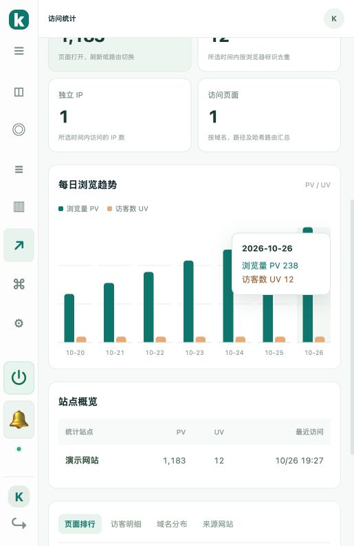
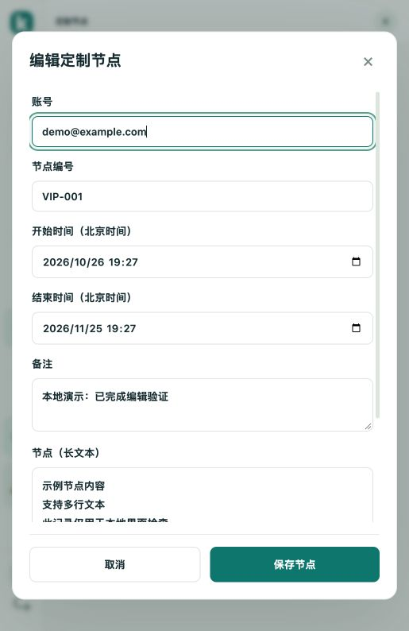

# 定制节点与每日流量提示

v1.13.0 新增以下功能。

## 每日 PV / UV

进入「访问统计」，将鼠标移到「每日浏览趋势」任意一天，即时显示该日日期、浏览量 PV 和访客数 UV。零访问日期也显示 0；不需要等待浏览器原生提示。

键盘可用 Tab 聚焦每天的柱形图；手机点击柱形图也可查看。日期按北京时间统计，提示会跟随站点和时间范围筛选更新。



## 定制节点

左侧菜单点击「定制节点」，再点击「添加节点」。填写：

| 字段 | 说明 |
| --- | --- |
| 账号 | 必填，最多 200 字 |
| 节点编号 | 必填，最多 100 字 |
| 开始时间 | 必填，北京时间 |
| 结束时间 | 必填，北京时间，须晚于开始时间 |
| 备注 | 可选，最多 2000 字，支持换行 |
| 节点（长文本） | 必填，最多 65,536 字，支持多行粘贴 |

点击「保存节点」后显示在列表中。每条记录右侧都有「编辑」按钮，可以修改以上所有字段并查看完整节点内容。长文本区域可以滚动，保存与取消按钮固定可见。

列表支持按账号或节点编号搜索，每页 50 条；刷新页面保持在定制节点页面，并保留当前搜索条件。节点资料仅登录的客服可见。

其他客服修改同一条记录时，保存会提示冲突，保留当前输入；点击「载入最新记录」后，基于新记录继续修改。该按钮会替换当前未保存的输入。

定制节点用于登记账号和节点信息，数据独立于聊天记录；刷新、服务器重启和升级后保留，数据库备份包含这些记录。



## 升级

```bash
bash /opt/kivo/scripts/upgrade.sh
```

如果服务器仍使用旧仓库下载地址，首次切换执行：

```bash
KIVO_RELEASE_BASE=https://github.com/hainiu3/Kivo/releases bash /opt/kivo/scripts/upgrade.sh
```

成功后刷新后台。
