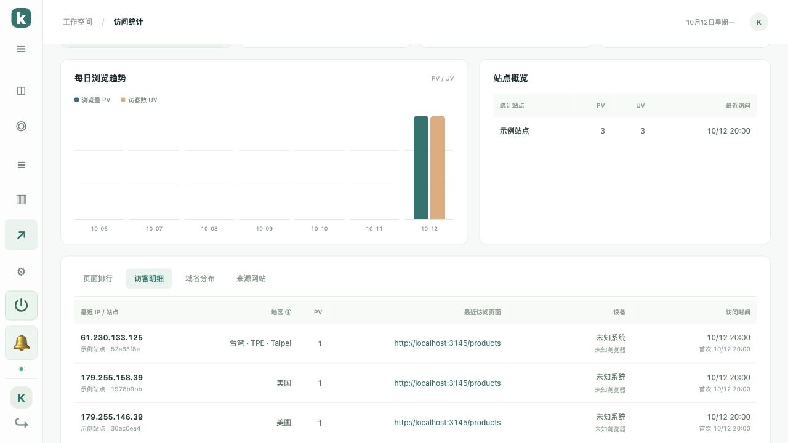

# IP 地区识别

v1.9.2 使用 DB-IP 2026 年 10 月的本地国家库，覆盖 IPv4 / IPv6。`179.255.146.39`、`179.255.158.39` 现在显示为「美国」，不再显示旧库的巴西城市。数据来源：[DB-IP Lite](https://db-ip.com/db/lite.php)，许可为 [CC BY 4.0](https://creativecommons.org/licenses/by/4.0/)，下载日期、地址与校验值保存在 [数据清单](../server/geo/manifest.json)。

国家以新版库为准。旧库的省份、城市仅在两者国家一致时保留；国家不一致时只显示国家，避免把旧城市拼到新国家后面。IP 地理位置仍是估算，可能受到地址迁移、VPN、代理及数据库更新速度影响。

客服访客信息与访问统计的访客明细都会按当前库重新计算显示地区。升级后刷新后台即可更新历史记录的显示，无需清空会话或统计；PV、UV、消息、原始访问记录均保留。新访问记录直接保存新版地区。



服务器执行：

```bash
bash /opt/kivo/scripts/upgrade.sh
```

升级后强制刷新后台。地区查询全部在本地完成，不把访客 IP 发给外部查询服务。这个更新只修正地区估算；如果 IP 本身是 `172.17.0.1`，仍需设置反向代理请求头与 `TRUST_PROXY=1`，见 [部署说明](../README.md)。

## 使用自己的地区库

可以把有使用许可的 Country / City MMDB 放到 `/opt/kivo/data/geoip.mmdb`，也支持 gzip 压缩后的 `/opt/kivo/data/geoip.mmdb.gz`。两者都存在时优先使用未压缩文件；修改后只需重新启动 Kivo 容器：

```bash
bash /opt/kivo/scripts/docker.sh restart kivo
```

City 库可提供自己的省份与城市。自定义库缺少某个 IP 时回退到内置国家库；无法读取或类型不正确时会记录提示并使用内置库。数据目录随升级保留，移除自定义库并重启可恢复内置库。

## 维护内置库

维护者在仓库中执行 `npm run geoip:update -- YYYY-MM`，例如 `npm run geoip:update -- 2026-10`。脚本从 DB-IP 官方下载指定月份的数据，检查文件大小、数据库类型和月份，再更新库与 SHA-256 清单。运行测试后随新版本镜像发布；服务器无需额外安装数据库软件。
