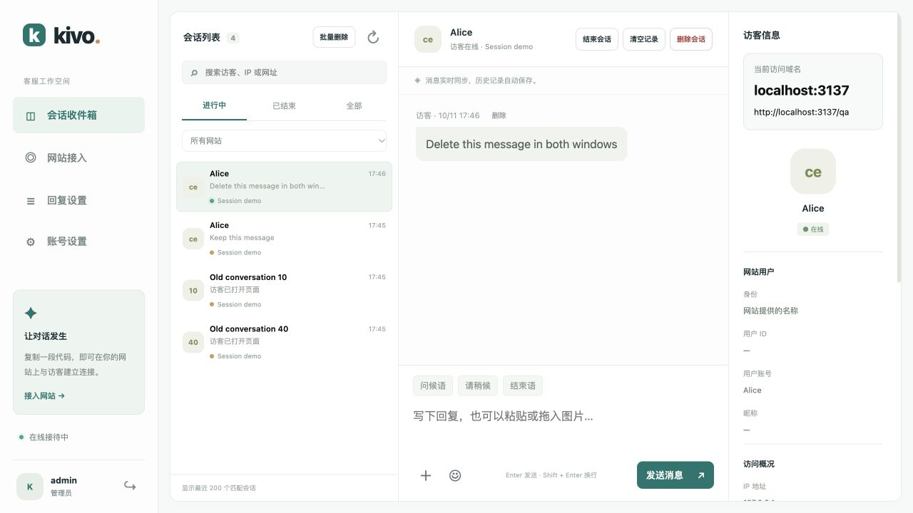
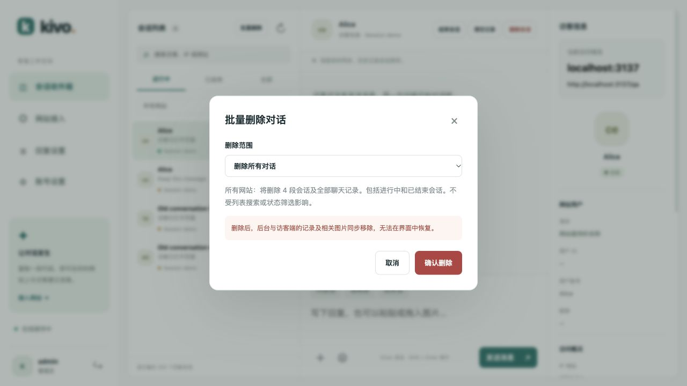
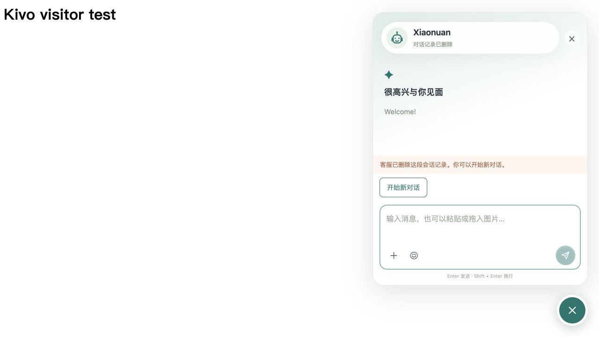

# 记录管理与访客 IP

Kivo v1.5.0 增加后台记录管理。网站嵌入代码保持不变，服务升级后强制刷新后台和接入网站。



## 删除范围

- 消息旁的「删除」移除单条文字、图片或动态表情，访客窗口及其他客服同步更新。
- 当前聊天顶部的「清空记录」清除该会话全部消息、图片和待发送图片，保留访客会话，之后可继续聊天。
- 「删除会话」同时移除会话、消息、图片及用户关联。访客窗口清空，点击「开始新对话」或重新打开窗口后建立空白会话。
- 列表顶部「批量删除」提供全部、7 天前、一个月前（30 天）三个范围。按会话的最近消息时间筛选；旧会话最近收到过消息时保留。
- 批量操作作用于「筛选网站」选择的网站；选「所有网站」时覆盖全部网站。它不受搜索词或进行中／已结束选项限制，也不限于列表显示的 200 条。
- 确认前会显示数量。预览后新建的会话不在「全部」删除范围内；按时间删除时，预览后收到新消息的会话也会保留。
- 删除保留网站配置和客服头像。访客离线时，下次重新加载会话获取删除后的记录。历史加载响应或发送确认不会将已删消息重新显示。





## 宝塔反向代理下的真实 IP

`172.17.0.1` 是 Docker 网关地址。反向代理部署时，宝塔需要转发真实地址，Kivo 需要启用对这一个代理的信任。

在宝塔中，对客服域名的反向代理使用 `http://127.0.0.1:8088`，确保代理 `location` 含有以下配置（存在时修改原行，不要重复添加）：

```nginx
proxy_set_header Host $host;
proxy_set_header X-Forwarded-Proto $scheme;
proxy_set_header X-Forwarded-For $remote_addr;
proxy_set_header X-Real-IP $remote_addr;
proxy_http_version 1.1;
proxy_set_header Upgrade $http_upgrade;
proxy_set_header Connection "upgrade";
```

在 `/opt/kivo/.env` 设置：

```dotenv
PUBLIC_URL=https://kivo.2222255.xyz
TRUST_PROXY=1
BIND_HOST=127.0.0.1
HTTP_PORT=8088
```

然后运行：

```bash
bash /opt/kivo/scripts/upgrade.sh
```

升级重新创建容器并载入新环境变量；单纯重启旧容器不更新变量。仅暴露本机端口，由宝塔接收外部连接，配合代理覆盖转发头。原先使用 IP:8088 直接访问的页面需使用 HTTPS 客服域名。

应用在首次访问和实时连接重连时更新 IP 与地区。已离线的旧记录会在该访客再次访问后更新，无法从历史 Docker 网关地址还原原始 IP。未启用 `TRUST_PROXY` 的直连部署忽略外部提交的转发头。
