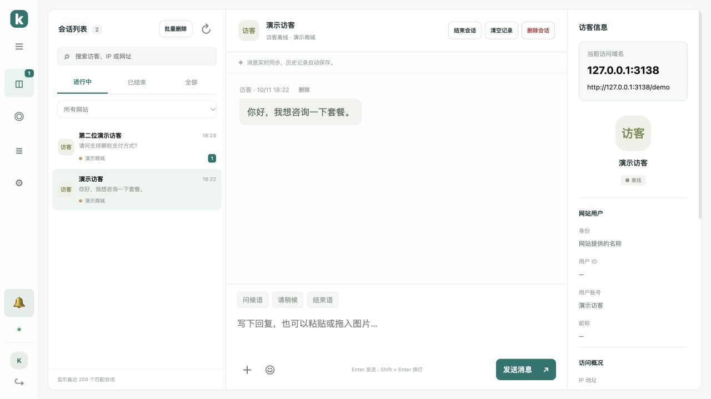

# 新消息提示与折叠菜单

v1.8.0 将后台新消息提示音改为简洁的一声「叮」。后台收到访客的文字、图片或表情时响铃；客服发送的消息、自动回复、加载历史和重复投递不会触发提示音，连续快速到达的消息合并提示音。

浏览器首次打开工作台后需要一次点击或键盘操作才能启用声音。菜单下方的「♫」按钮可直接启用并试听，启用后显示「🔔」，再次点击静音。静音偏好保存在当前浏览器。音频被浏览器限制时，按钮保留「点击启用提示音」提示，未读数字仍正常显示。

浏览器标签标题显示「(N 条未读) Kivo · 客服工作台」，标签图标显示红色提示点。菜单的会话入口也显示未读角标。统计覆盖所有网站、所有会话状态及最近 200 条列表之外的记录，不受搜索和筛选影响。打开并查看会话后，对应未读数字清除；其他客服已读、删除消息及清空会话时也会同步更新。全部读完后恢复普通标题与图标。

左侧菜单默认收起为图标栏，鼠标停留可看到入口名称。点击左上方「☰」展开，再点击「‹」收起。当前浏览器记住选择；窄屏展开时浮在内容上方，选择入口后收起。折叠状态仍可切换页面、查看未读角标、控制声音和退出登录。



服务器升级后强制刷新后台：

```bash
bash /opt/kivo/scripts/upgrade.sh
```

测试覆盖音频激活、静音偏好、访客消息与重复去重、突发消息合并、标签和角标、已读/删除后的计数刷新、异步请求竞争以及退出登录后旧响应隔离；真实 HTTP 测试验证未读接口权限和超过 200 条、跨网站及状态的统计。
