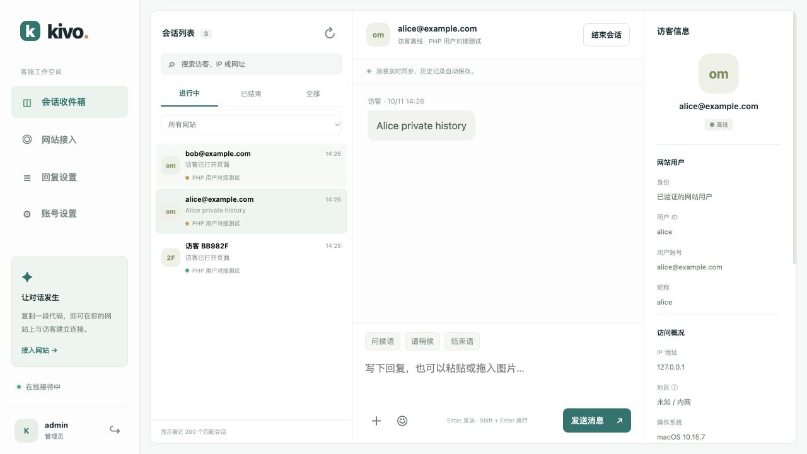

# PHP 网站用户对接

只需读取 Session 中的 `username` 并显示名称时，推荐 [Session 直接显示模式](session-name.md)：替换一段 PHP / Blade 嵌入代码即可，不需要本页的身份接口、控制器和签名密钥。以下是需要验证账号并跨设备恢复历史时的可选方案。

Kivo v1.4.0 起支持网站登录用户。客服后台会显示 **用户 ID、账号、昵称**，可搜索这些字段；同一网站、同一用户 ID 在不同设备登录时恢复同一份聊天记录。未登录访客仍可咨询，其记录与登录账号分开保存。

网站文件由你自行部署。下面的示例均保存在 Kivo 仓库中；不需要修改网站的登录流程或数据库结构。



## 1. 在 Kivo 生成密钥

升级 Kivo 并刷新后台，打开 **网站接入 → 对应网站 → PHP 用户对接 → 生成密钥**。复制网站 ID 和后端签名密钥。密钥只写入 PHP 后端配置，不放在 HTML、JavaScript、公开目录或 Git 仓库中。

网站和客服地址应使用 HTTPS。沿用已有 HTTPS 反向代理，参见 [README](../README.md#https-与已有网站共存)。网站的允许来源须包含实际网站地址，或勾选允许所有网站。

## 2. 你的 Laravel 5.4 网站

根据你提供的网站源码，登录用户保存在 `Session::get('user')` 数组中，用户模型是 `App\Http\Models\User`，稳定用户 ID 是 `id`，账号是 `username`。现有模型没有独立昵称字段，示例将昵称留空。控制器用 Session 中的 ID 查出当前账号，不接收浏览器提交的账号信息。

请将这些文件自行复制到网站相应目录（左侧是本仓库文件）：

| Kivo 仓库文件 | 网站目标文件 |
| --- | --- |
| `examples/php/KivoIdentity.php` | `app/Components/KivoIdentity.php` |
| `examples/laravel54/app/Http/Controllers/KivoController.php` | `app/Http/Controllers/KivoController.php` |
| `examples/laravel54/config/kivo.php` | `config/kivo.php` |
| `examples/laravel54/resources/views/user/kivo-verified.blade.php` | `resources/views/user/kivo-verified.blade.php` |

在网站 `routes/web.php` 中新增这一条路由，放在要求登录的 `user` 中间件组之外。Laravel 的 web Session 中间件仍会生效，未登录时返回匿名身份，不跳转登录页面：

```php
Route::get('kivo/identity', 'KivoController@identity')->middleware('throttle:60,1');
```

在网站服务器的 `.env` 加入以下配置，替换示例值：

```dotenv
KIVO_ENABLED=true
KIVO_URL=https://chat.example.com
KIVO_SITE_ID=从客服后台复制的网站ID
KIVO_IDENTITY_SECRET=从客服后台复制的64位密钥
```

在 `resources/views/user/layouts.blade.php` 的底部，将现有 Salesmartly 客服 `<script>` **替换**为：

```blade
@include('user.kivo-verified')
```

此模板在 Kivo 未启用或地址、网站 ID 未填写时保留原有客服脚本，启用后加载 Kivo，避免重复出现两个客服组件。网站登录页和其他布局如需显示客服，也可按需加入该模板。

新增路由及配置后，在网站服务器的项目目录执行（不是客服服务器的 `/opt/kivo`）：

```bash
php artisan config:clear
php artisan route:clear
php artisan view:clear
php artisan route:list --path=kivo
```

路由列表应包含 `GET|HEAD kivo/identity` 和 `KivoController@identity`。然后在未登录的浏览器访问网站自己的 `/kivo/identity`，应返回 `{"identityToken":null}`；登录后返回带签名凭证的 JSON。该接口属于业务网站，例如 `https://126game.cc/kivo/identity`，不放在 Kivo 客服域名上。

访问已登录网站后，打开客服发送一条消息，在 Kivo 会话右侧应看到「已验证网站用户」、对应用户 ID 和账号。

## 3. 普通 PHP 网站

使用 `examples/php/KivoIdentity.php` 和 `examples/php/kivo-identity.php`，将后者放在网站自己的 PHP 可访问目录中。按网站现有 Session 将 `user_id`、`username`、`nickname` 映射到真实字段；密钥从服务器环境变量或站点私有配置读取。不要直接使用 GET / POST 参数声明用户身份。

网页嵌入代码如下（身份接口与网站同源）：

```html
<script src="https://chat.example.com/widget.js"
        data-site="客服后台的网站ID"
        data-identity-url="/kivo-identity.php"
        async></script>
```

接口始终返回 JSON。已登录时返回 `{"identityToken":"后端签名凭证"}`，未登录时返回 `{"identityToken":null}`；响应须使用 `Cache-Control: no-store, private`。Laravel 示例的接口路径是 `/kivo/identity`。

## 登录、退出和历史记录

- 凭证由 PHP 使用 HMAC-SHA256 签名，有效期 15 分钟；加载器每分钟及页面重新可见时读取网站登录状态、刷新凭证。
- 常规页面跳转会重新读取身份。AJAX 登录、退出或切换账号成功后，立即调用 `window.Kivo?.refreshIdentity()`。调用时清空当前窗口的会话和附件，再按新身份加载历史。
- 同一用户 ID 在同一网站恢复历史，账号更名不创建新会话。不同网站、不同用户、匿名访客的记录互相隔离；不会自动把匿名历史合并到账号。
- PHP 接口异常或签名无效时停止聊天并显示错误，不降级为匿名账号。凭证到期后，服务端也会断开对应连接并拒绝图片访问。
- 退出登录后浏览器刷新身份，旧凭证仍可能有效至其 15 分钟期限结束。需要立即撤销某个用户的所有设备时，当前版本尚无逐用户撤销接口；重置网站密钥会立即撤销该网站所有已签名凭证，并要求同步更新 PHP 配置。
- 后台「关闭对接」也会撤销已签名凭证。随后应移除网页的 `data-identity-url` 或关闭 PHP 模板配置；普通匿名嵌入代码仍可使用。

## 签名格式与排查

`KivoIdentity::sign($siteId, $secret, $userId, $account, $nickname)` 生成两段 base64url：JSON 载荷和第一段的 HMAC-SHA256，使用 `.` 连接。载荷包含 `siteId`、`userId`、`account`、`nickname`、`iat`、`exp`。**64 位密钥作为原始字符串使用，不进行 hex 解码**。这不是三段式 JWT，请直接使用提供的 PHP 帮助类。

用户 ID、账号最多 128 个 UTF-16 代码单元，昵称最多 80 个，ID 与账号必填，昵称可为空；所有字段须为 UTF-8 且不含控制字符。PHP 和 Kivo 服务器时间应同步。

- 接口返回 HTML / 登录跳转：检查是否把路由放进了强制登录中间件，或 PHP 路由未生效。
- 接口显示「页面不存在」但 HTTP 状态为 200：网站自定义错误页也可能返回 200，仍不是有效身份接口。检查 PHP 文件是否已复制到线上网站、路由是否已添加并清除缓存；如果路由列表有该条目，检查宝塔 Laravel 伪静态是否将 `/kivo/identity` 转交给 `public/index.php`。
- HTTP 503：检查网站后端四项配置，尤其密钥是否完整；不要把签名密钥或完整凭证贴到公开日志中。
- 签名无效：网站 ID 和密钥必须来自同一个 Kivo 网站；重置后需更新 PHP 配置并清理配置缓存。
- 仅显示匿名：检查网站 Session 是否已初始化，字段是否映射正确，嵌入代码是否含 `data-identity-url`。

Kivo 一键升级会保留网站密钥、用户关联、原有会话和图片。密钥保存在 Kivo SQLite 中，数据库与备份都应保留为私有文件。
