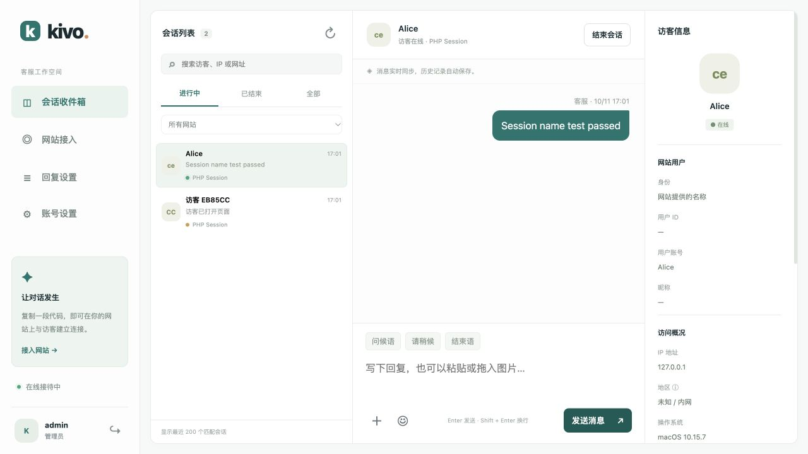

# 直接从 PHP Session 显示访客名称

Kivo v1.4.1 支持简化接入：PHP 页面把已有 Session 中的 `username` 输出到客服脚本，客服后台直接显示该名称；没有用户名时显示默认的「访客 + 编号」。无需新增身份接口、路由、控制器、签名密钥或数据库查询。

JavaScript 无法直接读取服务器的 PHP Session，读取发生在网站渲染页面时。网站文件由你自行替换，Kivo 不修改网站目录。



## Laravel 网站：替换一段客服代码

在你的网站 `.blade.php` 模板中，用下面这段替换原客服脚本。`src` 和 `data-site` 保留你现有客服域名及网站 ID，移除旧的 `data-identity-url`。

也可以在后台 **网站接入 → 对应网站 → 复制 PHP Session 代码**，直接复制已填入客服域名和网站 ID 的代码。普通「复制嵌入代码」仍用于不读取 Session 的 HTML 页面。

```blade
<script src="https://你的客服域名/widget.js"
        data-site="你现有的网站ID"
        data-visitor-name="{{ Session::get('user.username', Session::get('username', '')) }}"
        async></script>
```

针对你提供的网站，代码先读 `Session::get('user')['username']`，其次读顶层 `Session::get('username')`；缺少时返回空值，Kivo 使用默认访客名。Blade 会自动转义引号和 HTML 字符，避免用户名破坏脚本标签。

如果已经复制了 Kivo 的 `user/kivo.blade.php` 并配置 `KIVO_URL`、`KIVO_SITE_ID`，用本仓库最新版 `examples/laravel54/resources/views/user/kivo.blade.php` 替换该模板即可；签名密钥不用于此模式。

模板缓存清理命令，在网站项目根目录执行：

```bash
php artisan view:clear
```

同时升级 Kivo 服务，再强制刷新网站和客服后台：

```bash
bash /opt/kivo/scripts/upgrade.sh
```

## 普通 PHP 网站

`examples/php/kivo-session.php` 是单文件嵌入示例。修改顶部的客服 URL、网站 ID 后，将它放在网站非公开目录，从已有 PHP 页面底部 `include`。它直接读取已初始化的 Laravel Session 或原生 `$_SESSION['user']['username']` / `$_SESSION['username']`，不存在或不是字符串 / 数字时按匿名访客处理。

```php
<?php include '/你保存文件的绝对路径/kivo-session.php'; ?>
```

网站原生 PHP 登录流程需在输出页面前初始化自己的 Session；嵌入文件不会启动另一套 Session，也不修改登录状态。

## 聊天记录与名称

- 后台在会话列表和用户账号栏显示名称，身份标注为「网站提供的名称」；没有名称时标注为「匿名访客」。
- 这是一项显示信息，不作为已验证账号或登录凭证。相同用户名不能读取另一个访客的聊天记录，图片访问仍要求对应访客凭证。
- 同一浏览器、同一名称使用自己的访客凭证恢复历史，不同名称和匿名访客分别保存；换设备不会仅凭用户名合并记录。需要跨设备恢复账号历史时，可选用 [签名身份模式](php-integration.md)。
- 用户名随 PHP 页面渲染更新。普通登录、退出的页面刷新会重新读取 Session；单页 AJAX 登录或退出后应重新加载页面，以更新嵌入属性。
- 个人化页面应按用户动态渲染，避免把含用户名的 HTML 作为公共缓存分发给其他访客。
