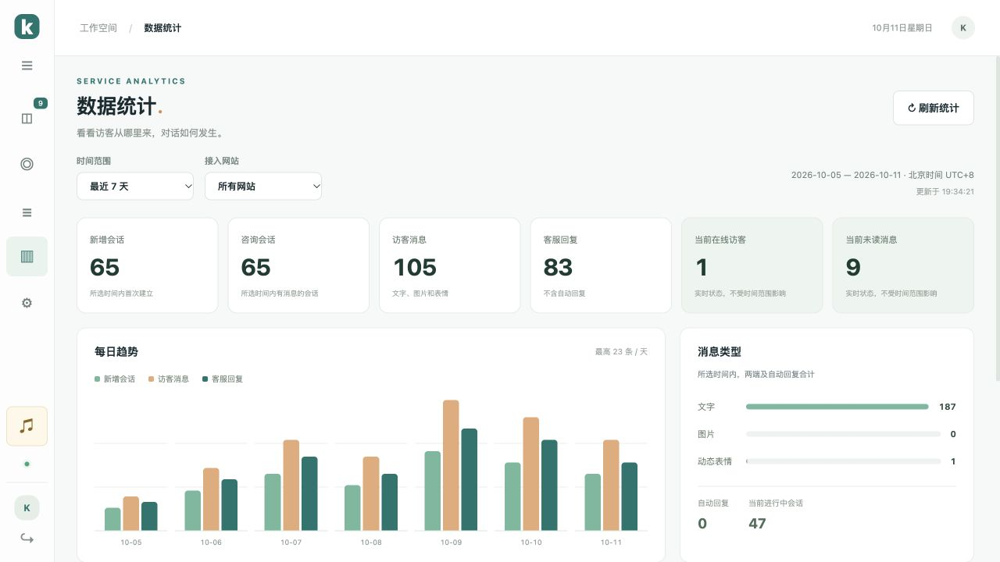
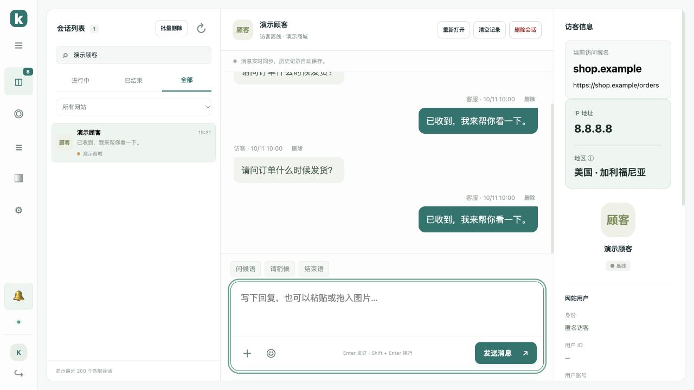

# 数据统计与会话界面更新

v1.7.0 新增左侧「数据统计」入口，折叠菜单时使用「▥」图标。

## 统计内容

- 时间范围：今天、最近 7 / 30 / 90 天，均包含今天，按北京时间 UTC+8 汇总。
- 网站筛选：所有网站或单个接入网站，刷新后保留当前页面和筛选条件。
- 新增会话：所选时间内首次建立的会话，访客刷新同一会话不会重复计数。
- 咨询会话：所选时间内有消息的会话，同一会话跨多天、多条消息仍只统计一次。
- 访客消息、客服回复：包括文字、图片和动态表情；客服回复不包含自动回复。
- 当前在线访客：按会话去重，同一访客的多个浏览器标签不会重复计数；不受所选时间范围影响。
- 当前未读消息、进行中会话：所选网站的当前状态，不受所选时间范围影响。
- 每日趋势、消息类型、网站分布和每日明细。自动回复单独显示，消息类型包含两端及自动回复。

数据从当前保留的全部会话和消息汇总，不受会话列表最近 200 条或列表搜索条件影响。删除会话、消息或清空记录后，历史统计随之更新。统计页面可见时每 30 秒更新，收到新消息及记录删除事件后自动更新，也可点击「刷新统计」。

长时间范围的趋势图默认定位到最近日期，可水平滚动查看较早日期；展开每日明细可以查看具体数字。



## 会话界面

聚焦回复框时，完整的圆角描边包住文字、图片、表情和发送按钮；输入区域不再单独出现第二圈描边。点击会话卡片后光标立即聚焦输入框，后台重连和其他页面加载历史不会抢走焦点。

右侧 IP 地址和地区位于访问域名下方，以醒目卡片和加大、加粗的深色文字显示。IP 来源与信任代理配置仍按 [记录管理及访客 IP](history-management.md) 设置。



## 升级

```bash
bash /opt/kivo/scripts/upgrade.sh
```

升级后强制刷新后台。原有聊天记录、图片、网站、30 天登录和 PHP 用户配置会保留。

验证覆盖统计接口权限、跨网站超过 200 条记录、北京时间零点、时间及网站筛选、空数据、消息类型、在线会话去重、删除后重新汇总、异步响应竞争、退出后旧响应隔离和刷新恢复。浏览器实测完整描边、点击聚焦、统计筛选、刷新恢复及新消息实时计入统计。
