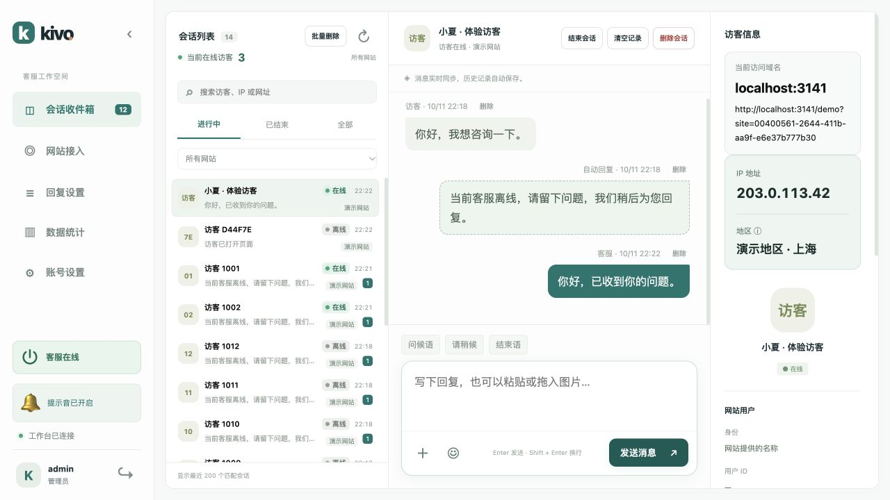
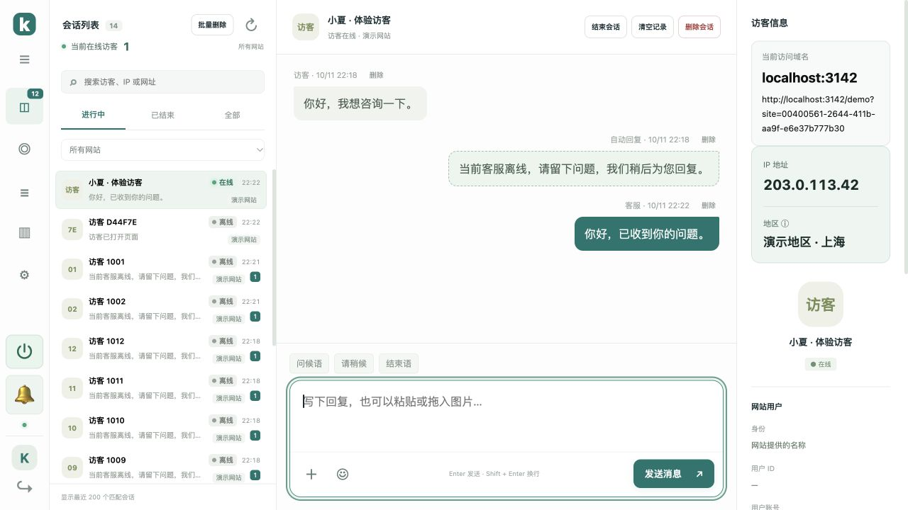
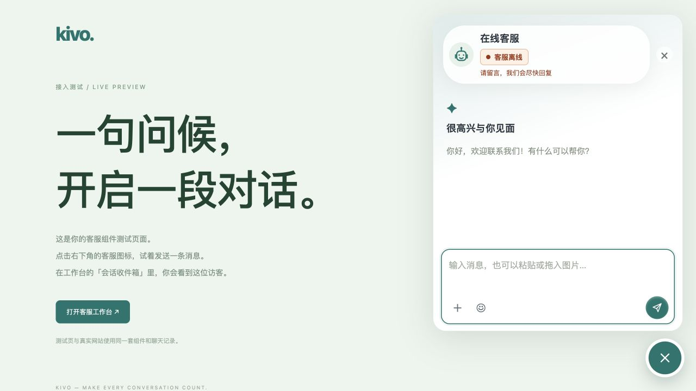

# 接待状态与紧凑会话列表

v1.8.0 在后台左下角新增电源图标开关。菜单展开时显示「客服在线」或「客服离线」；折叠时悬停可查看当前状态及切换操作。点击一次即可切换，所有已打开的后台实时同步。

- 设为在线且至少一个客服工作台已连接时，访客端显示客服在线。
- 设为离线后，访客端实时显示客服离线，访客仍能留言，客服仍能在后台接收和回复。
- 「回复设置」中已启用的离线自动回复，会在主动离线时生效；首次自动回复及五分钟冷却规则继续适用。
- 接待状态是服务共用设置，刷新页面或服务重启后保留。所有工作台关闭或断开时，访客端自动显示离线；重新连接后仍遵循保存的设置。
- 「工作台已连接／连接已断开」表示后台的网络连接，与选择的接待状态分别显示。

## 会话列表

会话卡片改为两行，高度 54px：第一行为访客名称、绿色「● 在线」或灰色「● 离线」及时间；第二行为消息摘要、网站及未读数。长名称及摘要省略显示，网站名称悬停可查看全文。

收件箱顶部显示当前在线访客数，统计所有网站、所有会话状态，不受搜索、网站筛选或最近 200 条列表限制。同一会话在多个标签中打开只计一次；最后一个连接关闭、会话被删除时自动更新。人数表示实时连接的会话数，而非网站总访问量。



## 声音与图标

提示音改为简洁的一声「叮」，快速连续消息合并提示。加载历史、客服回复和重复消息不响铃。浏览器仍需一次点击来允许播放；左下角的铃铛按钮可启用、试听或静音。声音、接待开关、账号及退出图标加大；小高度窗口隐藏接入引导卡，保留底部操作空间。

## 会话界面简化

v1.8.1 去掉三栏会话区域的外边框、圆角、阴影及外围留白，并删除聊天标题下的同步提示条。会话列表、聊天内容及访客信息铺满可用空间。



## 升级

```bash
bash /opt/kivo/scripts/upgrade.sh
```

升级完成后强制刷新后台。原有聊天记录、图片、网站、30 天登录及 PHP 用户配置保留。

## v1.9.1 状态与提示音调整

访客窗口头部用绿色「客服在线」或橙色「客服离线」标签区分接待状态。离线标签下方显示「请留言，我们会尽快回复」，留言输入和发送仍可使用。网络断开、重连、连接失败和会话删除显示各自状态，不会保留上一次在线标签。

双方输入框移除「Enter 发送 · Shift + Enter 换行」提示文字，快捷键保持可用。

新消息提示音换为更清晰的一声「叮」：提高合成声音的增益，并延长到约 0.66 秒。点击左下角铃铛可开启并试听；静音偏好、连续消息合并和重复消息去重保持有效。实际响度也取决于电脑音量及浏览器是否允许播放。



## v1.11.1 提示音选择

后台「账号设置」新增 5 种更响亮的声音，均可单独试听并自动记住选择。左下角铃铛继续控制开启和静音，静音时仍可试听。查看 [声音说明和试听文件](message-notifications.md)。
