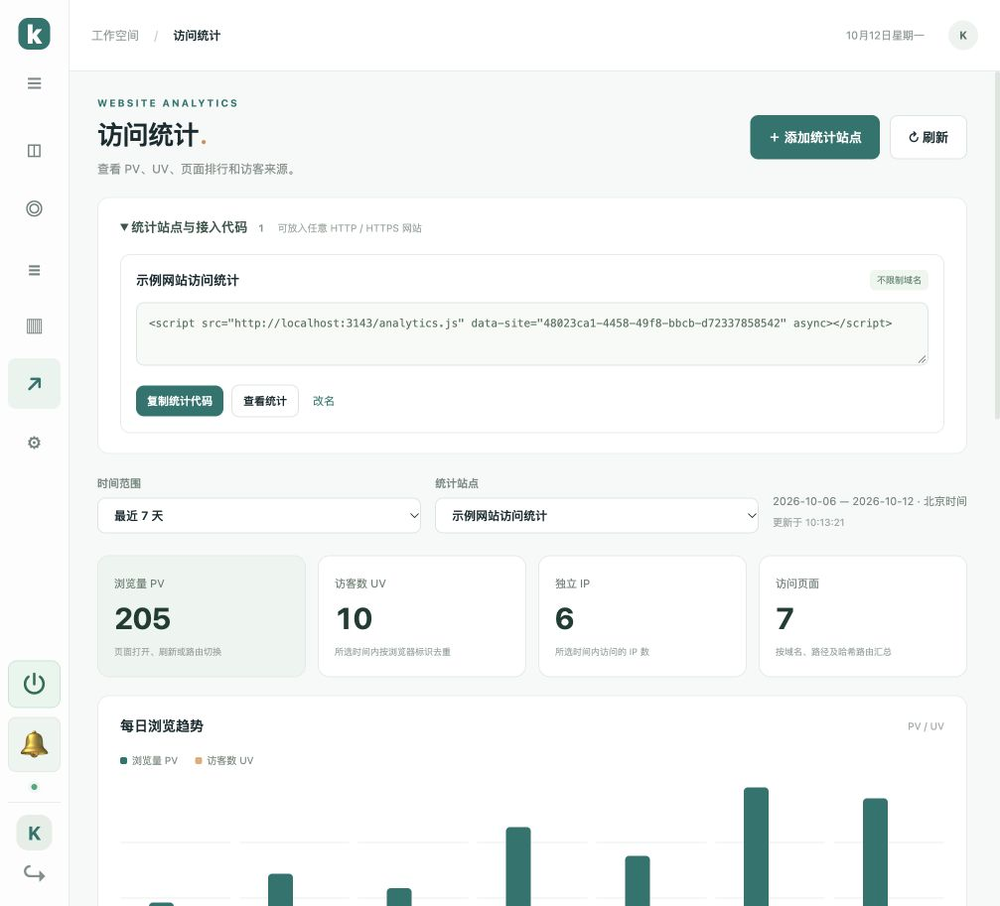
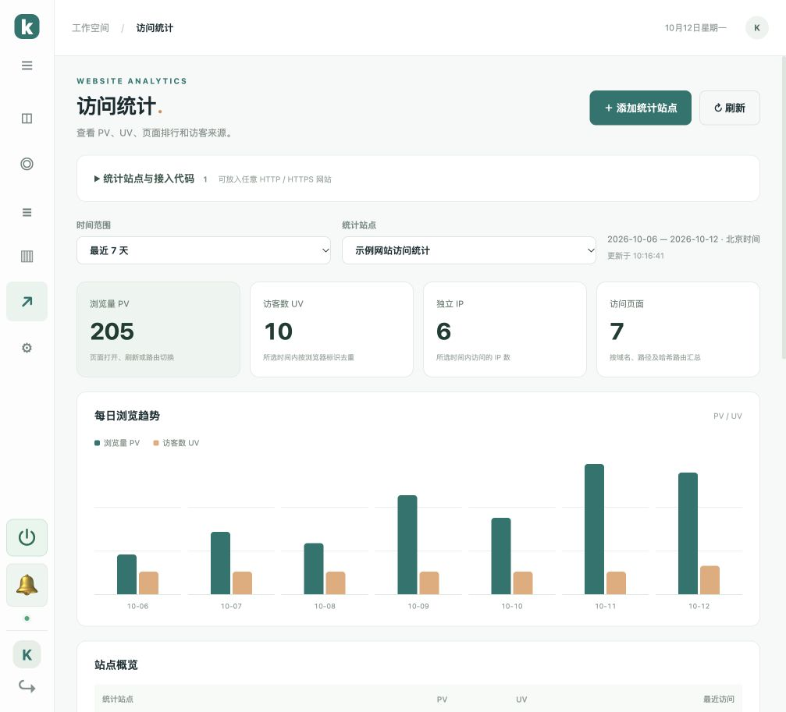
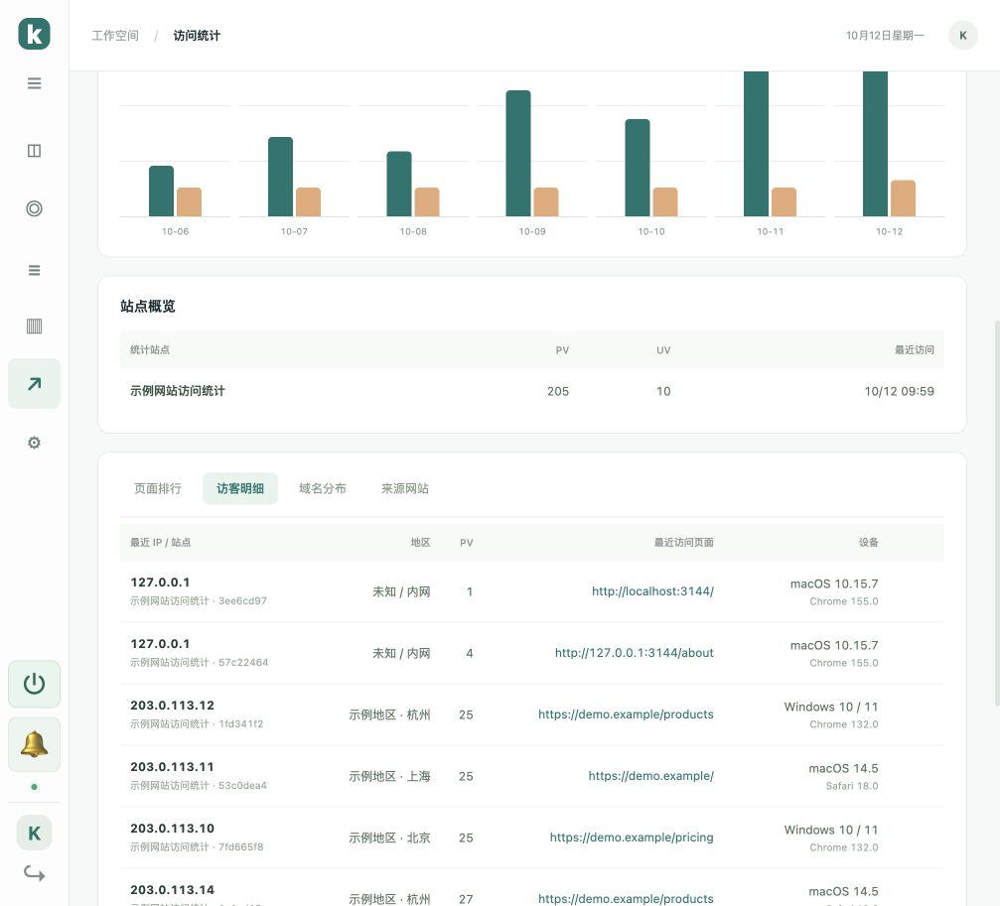

# 访问统计：PV、UV 与页面访问量

v1.9.0 新增独立的「访问统计」模块。统计站点只需填写名称，不限制域名；同一段 JS 可以嵌入多个 HTTP / HTTPS 网站。

## 接入步骤

1. 后台左侧点击「访问统计」。
2. 点击「添加统计站点」，填写站点名称并保存。
3. 展开「统计站点与接入代码」，点击「复制统计代码」。
4. 将整段代码放在需要统计的网站 HTML 中，建议放在 `</body>` 前。
5. 打开或刷新网站，再到后台点击「刷新」查看数据。

生成的代码使用客服服务的 `PUBLIC_URL`。HTTPS 网站使用 HTTPS 服务地址。每个统计站点都有独立 ID，代码可以用于任意域名，无需添加白名单。此脚本只负责访问统计，可与客服 `widget.js` 同时使用；统计站点和客服网站分别管理。



## 统计内容与口径

- **PV**：每次页面打开、刷新或页面路由切换计一次。上报重试使用相同事件 ID，重复请求不会重复计数。
- **UV**：所选时间内按浏览器标识去重，同一浏览器在同域多个页面、标签及刷新时保持标识。不同设备、不同浏览器或清理存储后会产生新标识。浏览器存储按域名隔离，因此跨域访问分别计入 UV；「所有统计站点」也按站点标识区分访客。
- **独立 IP**：所选时间内出现的不同 IP 数，不等同于 UV。同一出口 IP 可以有多位访客。
- **页面排行**：展示页面标题、地址、PV、UV、最近访问时间。按协议、域名、路径及 `#/...` 哈希路由汇总，剔除查询参数和普通锚点，避免同页因参数不同被拆分。
- **访客明细**：展示最近 IP、地区、访问次数、最近页面、操作系统、浏览器、首次及最近访问时间。每个浏览器标识一行，IP 变化时展示最近一次 IP；同一 IP 下的不同标识分别展示。
- **域名分布、来源网站**：PV / UV 排行。来源依据页面 referrer 或上一次单页路由，包含站内来源；无来源信息归入「直接访问」。各排行显示前 50 项。
- **时间范围**：今天、最近 7 / 30 / 90 天，按北京时间 UTC+8 汇总。每日 UV 不相加作为期间 UV，期间重新去重。

浏览趋势与站点概览覆盖所选范围的全部记录。页面、访客明细每页 50 项并支持翻页，列表页数不影响总量。筛选的站点、时间范围、明细标签及当前页面在刷新后恢复；页面可见时每 30 秒自动更新。





## 采集方式

脚本是异步加载的独立 JS，不改变网页布局或网站路由。记录首次加载、刷新、浏览器返回恢复；每秒检测单页应用地址变化，也监听返回与哈希路由事件。浏览器上报不携带客服登录凭证，IP 和地区由服务端确定，系统和浏览器依据请求中的设备信息识别。

数据从接入后开始记录，无法回填接入前的访问。统计依赖浏览器正常执行 JS 和成功上报；不等同于 Web 服务器日志，浏览器存储限制、脚本拦截和网络中断可能影响结果。

aaPanel / Nginx 后的真实 IP 使用现有 `TRUST_PROXY=1` 和转发头配置，见 [访客 IP 设置](history-management.md)。地区为 IP 估算。

## 升级、备份与保留

```bash
bash /opt/kivo/scripts/upgrade.sh
```

升级后强制刷新后台。将新生成的统计代码加入网站模板即可开始采集，无需修改现有客服接入代码。

统计站点和访问记录保存在同一个持久化 SQLite 数据库，随现有备份脚本备份，升级保留。聊天记录删除不会删除独立的访问统计数据。新表与索引是追加创建，兼容原有部署。
