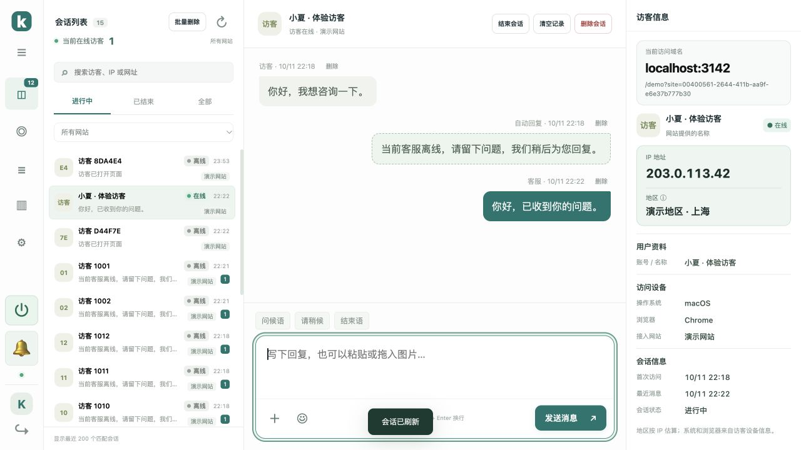

# 客服按钮与访客信息

v1.8.2 更新右下角客服按钮及后台会话收件箱的访客信息。

## 客服按钮

使用耳麦笑脸 SVG 图标，桌面尺寸从 26px 加大到 38px，窄屏为 34px。图标随网站主题色调整明暗，保留呼吸、悬停和打开／关闭切换效果。


## 访客信息

- 当前访问域名位于顶部，以加大、加粗的黑色文字展示；下方展示路径，最多两行，悬停查看完整 URL，点击打开当前访问页面。
- 头像缩为 38px，与名称、身份及在线／离线状态并排，长名称最多两行，悬停可查看全文。
- IP 与地区继续使用醒目卡片，减少卡片间距。
- 用户资料、访问设备、会话信息分组，以标签和值并排展示，空的用户 ID、账号／名称及昵称字段隐藏；匿名访客不显示空的用户资料分组。
- 桌面资料栏增加宽度，标题固定在顶部，较多信息可在栏内滚动查看。窄屏仍通过「访客信息」按钮打开抽屉。



## 访客备注

v1.12.0 在会话收件箱右侧「访客信息」中新增备注，同时移除左侧「让对话发生」引导卡片。网站接入入口仍在菜单中。

选择会话，在 IP / 地区下方的「访客备注」中输入内容，点击「保存备注」。最多 2000 字，支持换行；删除输入内容并保存即可清空备注。

- 备注仅登录的客服可见，不发送给访客、聊天窗口或客户端接口。
- 每条会话单独保存备注；切换会话会保留当前后台页面中未保存的草稿。刷新前需要点击保存。
- 保存的备注在刷新、服务器重启、备份及升级后保留。
- 多客服实时同步；其他客服修改时会保留你正在编辑的内容，并提示「载入最新备注」，防止覆盖。点击该按钮会丢弃当前未保存的草稿。
- 清空聊天记录保留备注；删除整条会话会一并删除备注。

## 升级

```bash
bash /opt/kivo/scripts/upgrade.sh
```

完成后强制刷新后台和接入客服的网站页面，以加载新样式及 `widget.js`。聊天记录、图片、网站设置、30 天登录及 PHP 用户配置保留。
