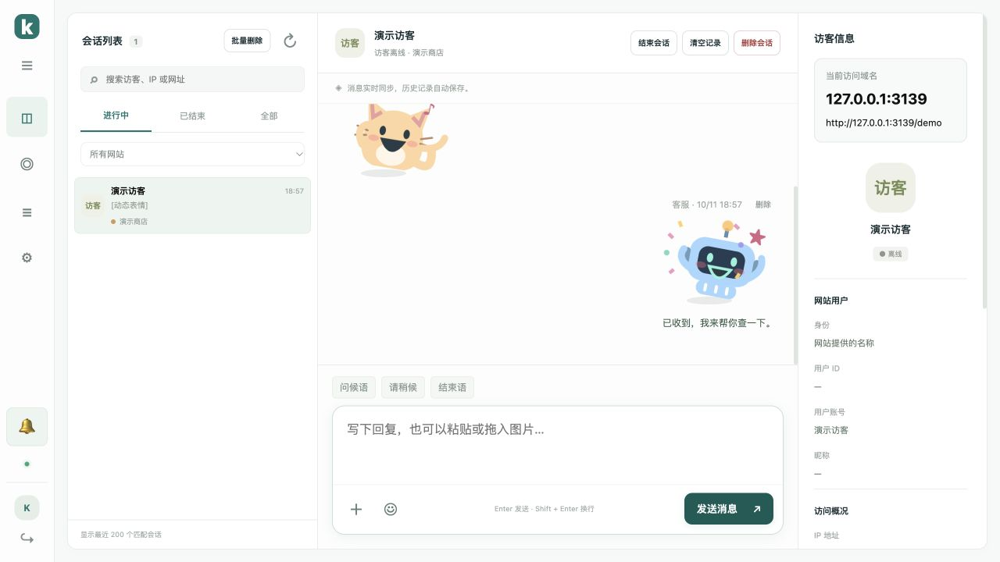
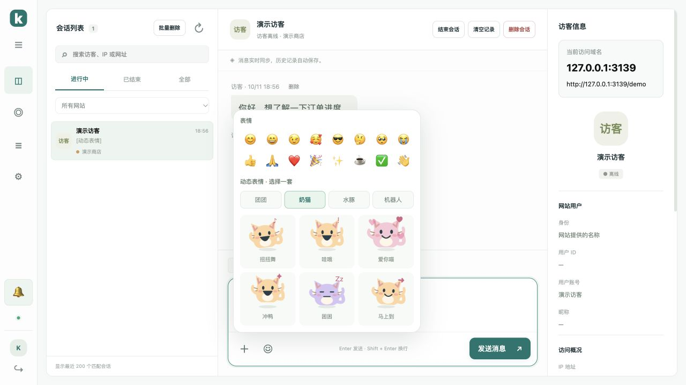

# v1.6.0 工作台与表情更新

新消息提示音改为响亮的四音提醒，可通过菜单下方声音按钮启用、试听或静音。浏览器仍要求一次点击或键盘操作才能播放声音。

管理员登录有效期为 30 天；每次刷新并成功恢复工作台后，从当前时间续期 30 天。升级时仍有效的旧登录会自动续期，已过期的登录需要重新登录。退出登录及修改密码仍会撤销相应登录凭证。

刷新后恢复当前模块、会话状态、网站筛选、搜索词、选中的访客和该会话的文字草稿。每个浏览器标签分别保存状态，退出后清除；未发送的图片附件不会保存。暂时网络失败显示重试入口，不误跳登录页。

后台回复框使用同一个圆角边框包住文字、图片、表情和发送按钮，聚焦时高亮。常用话术与附件预览位于上方。



访客窗口关闭时，收到新的客服回复或自动回复会自动展开，并滚动到新消息；自动展开不会抢走网站输入框的焦点。加载旧记录和重复收到同一条消息不会触发自动展开。

表情面板提供「团团」「奶猫」「水豚」「机器人」四套切换入口。在原有 8 个团团表情基础上新增 18 个：扭扭舞、爱你喵、泡汤啦、转圈圈、撒花花、满电出发等。跳跃、摇摆、旋转、爱心和纸屑动效更明显，两端均支持预览后发送。系统开启减少动态效果时停止动画。



在服务器执行升级，再强制刷新客服后台和接入网站：

```bash
bash /opt/kivo/scripts/upgrade.sh
```

现有嵌入代码可以继续使用，升级保留会话、图片、网站和 PHP 用户配置。

验证包括 30 天 Cookie 与服务端过期、旧登录续期、退出失效、刷新草稿恢复、网络重试、新回复自动展开及焦点保护、26 个表情两端发送和非法表情拒绝；浏览器实测后台刷新、套装选择、表情预览发送及访客自动展开。
